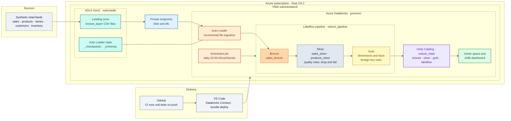
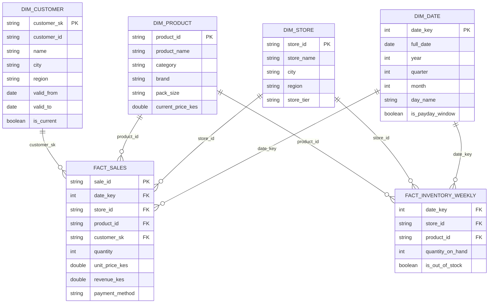
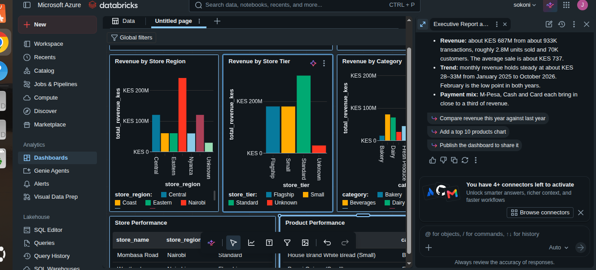
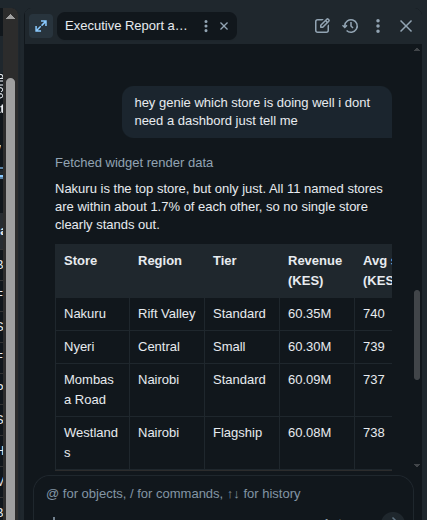
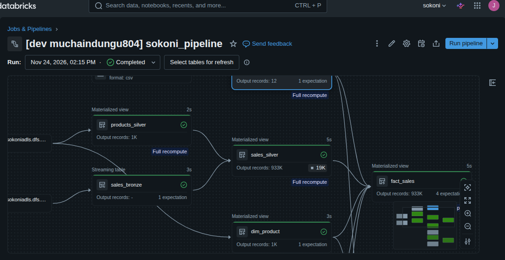

# Sokoni Retail Data Platform

An end-to-end data platform for a synthetic Kenyan supermarket chain with 11 stores. It ingests raw sales, product, store, customer, and inventory files from Azure Data Lake Storage, cleans them with quality rules, models them as a star schema with slowly changing customer history, and serves analytics through a Databricks Genie space and dashboard.

The data is generated, so every planted problem is known and every result can be checked.

---

## Architecture



### How the layers work

**Landing zone (ADLS Gen2).** Raw files arrive in the `sokoni` container under `bronze_layer/`, one folder per source: `sales/`, `products/`, `stores/`, `customers/`, `customer_changes/`, and `inventory/`. The storage account uses hierarchical namespace, which gives it real folders, and zone-redundant storage for durability. Public network access is disabled, so the account is reached only through private endpoints inside the virtual network.

**Ingestion (Auto Loader).** Auto Loader watches the sales folder and loads each new file exactly once. It keeps its progress in `_checkpoints` and its schema history in `_schemas`, stored in the same container. Those folders are the only state the ingestion needs, so resetting it is a matter of deleting them.

**Lakeflow pipeline (bronze, silver, gold).** One pipeline owns every table and its quality rules:

- **Bronze** keeps the data as it arrived, including the planted problems. Its rules warn but never drop rows, so the problems stay visible in the metrics.
- **Silver** cleans the data. Duplicate sale IDs are resolved by keeping a valid copy. Payment names are standardised, blank prices are filled from the product catalogue, and rows with invalid quantities are dropped and counted. A missing key stops the run.
- **Gold** builds the star schema. Foreign keys are checked as expectations, so a broken join fails the update instead of producing silent gaps.

**Governance (Unity Catalog).** Every table lives in the `sokoni_retail` catalog, in the `bronze`, `silver`, `gold`, and `lakeflow` schemas. Access and lineage are managed there, not in the code.

**Scheduling.** A Databricks job runs the pipeline every day at 02:00 Nairobi time, so the warehouse refreshes without anyone pressing a button.

**Consumption (Genie and dashboards).** Genie answers plain-English questions over the gold tables. The dashboard is built on the same tables, so every number on screen traces back to the star schema.

**Delivery.** Code is written in VS Code and connects to the Databricks workspace with Databricks Connect. The Databricks Asset Bundle deploys the pipeline and job from `databricks.yml`. GitHub runs the unit tests on every push to `main`.

### Network and security

- The Databricks workspace is deployed into the virtual network `sokoninetwork`, with secure cluster connectivity, so no public IP is assigned to compute.
- ADLS public network access is disabled. Storage traffic goes through private endpoints.
- Storage requires secure transfer and TLS 1.2 or later, and anonymous blob access is off.
- Storage encryption uses Microsoft-managed keys.

**Note on serverless compute.** The pipeline and job run on Databricks serverless compute, which runs on Databricks' managed network rather than inside the virtual network. The virtual network protects the workspace and the storage path, but not the serverless compute itself. A stricter setup would use classic compute injected into the virtual network.

---

## Pipeline in plain language

Think of the platform as a shop's back office.

1. **Deliveries arrive.** Every sale, product, store, customer, and stock count is written to a shared storage room as a file.
2. **A clerk logs each delivery.** Auto Loader notices new files and records them once, so nothing is counted twice.
3. **Checking and tidying.** The first clerk keeps the original slips exactly as they came. The second clerk fixes what can be fixed: spelling of payment methods, missing prices, and duplicate receipts. Anything impossible, such as a sale of 25 items when the valid range is 1 to 5, is set aside and counted.
4. **Filing for analysis.** The last clerk arranges everything into a catalogue of stores, products, dates, and customers, and a ledger of sales and stock. Each sale points to the right store, product, date, and the customer's address as it was on that day.
5. **Questions.** Managers ask questions in plain English through Genie, or look at the dashboard, which reads the same ledger.

The whole process runs each night and stops automatically if something important is wrong.

---

## Data model

The gold layer is a star schema: two fact tables surrounded by shared dimensions.



| Table | Grain | Rows |
|---|---|---|
| `fact_sales` | one product line in one transaction | 933,486 |
| `fact_inventory_weekly` | one store, one product, one week | 1,056,000 |
| `dim_date` | one calendar day, 2025 to 2026 | 699 |
| `dim_product` | one product | 1,000 |
| `dim_store` | one store, plus an `UNKNOWN` member | 12 |
| `dim_customer` | one version of one customer (SCD Type 2) | 76,999 (70,000 current) |

**Slowly changing customers.** A customer who moves city gets a new row with a valid-from date, and the old row closes on the day before. Each sale joins to the version valid on its sale date, so revenue by region reflects where the customer lived at the time. `customer_sk` is a hash of the customer ID and the version start date, so it stays the same on every rerun.

**The `UNKNOWN` store.** Sales with a blank store are labelled `UNKNOWN` rather than dropped. Their revenue still counts, and the foreign key still resolves.

---

## Data quality

The synthetic generator plants known problems in 15% of sales rows, so the quality rules have something real to catch:

| Problem | Share of rows | Handling |
|---|---|---|
| Duplicate `sale_id` | 5% | Keep the valid copy |
| Blank `store_id` | 4% | Label as `UNKNOWN` |
| Inconsistent payment name (`mpesa`, `CASH`, padded `card`) | 3% | Standardise |
| Invalid quantity (0 or 25) | 2% | Drop and count |
| Blank unit price | 1% | Fill from the product catalogue |

**Reconciliation.** One million rows enter bronze. After deduplication, 952,591 unique sales remain, of which 933,486 pass the quality rules and reach silver and the fact table, and 19,105 are dropped for invalid quantity. Every row is accounted for.

**Rule types.** Bronze rules warn, because the problems there are expected. Silver drops invalid rows and fails the run on a missing key. Gold fails the run on any broken foreign key.

**Dedupe rule.** When the same `sale_id` appears twice, the copy with a valid quantity is kept. If both are valid, a fixed sort order breaks the tie, so the result is the same on every run.

---

## Dashboard and Genie

The gold tables are exposed through a Genie space and an AI/BI dashboard.



Genie answers natural-language questions by generating SQL over the gold tables. Here is one question and its generated answer:



Questions the space is built to answer:

- What is total revenue by region and store tier?
- How does monthly revenue change across the payday window?
- Which products have the highest out-of-stock rate?
- How many customers moved region during the period?

**Limitation.** Inventory does not decrease when sales happen, so stock levels are not yet linked to sales. Stockout analysis should be read as a pattern in the synthetic data, not a business conclusion.

---

## Pipeline run



The graph shows each table, its output row count, and the expectation results from one run. Click any table in the workspace to see its full quality rule breakdown.

---

## Repository structure

```
sokoni_data_platform/
├── databricks.yml              # bundle: pipeline and daily job
├── pytest.ini
├── .github/workflows/ci.yml    # CI: unit tests on every push
├── docs/images/                # diagrams and screenshots for this README
├── src/
│   ├── bronze_layer/
│   │   └── ingestion.py        # Auto Loader ingestion of sales
│   ├── silver_layer/
│   │   ├── customers_transform.py
│   │   └── customers_scd2_transform.py
│   ├── gold_layer/
│   │   ├── dim_customer.py
│   │   └── facts_sales.py      # superseded, see legacy
│   ├── pipelines/
│   │   ├── bronze_sales.sql    # Lakeflow: bronze
│   │   ├── silver.sql          # Lakeflow: silver
│   │   ├── gold_dims.sql       # Lakeflow: dimensions
│   │   └── gold_facts.sql      # Lakeflow: facts
│   ├── common/
│   │   └── transforms.py       # rules shared by tests and the pipeline
│   └── legacy/                 # first-version scripts, kept for reference
└── tests/
    ├── unit/                   # 14 fast tests, no cloud needed
    └── data/                   # 11 warehouse tests, need a Databricks connection
```

---

## Running it

**Prerequisites:** Python 3.10, the Databricks CLI, and access to the Azure Databricks workspace.

**1. Set up the environment**

```bash
uv venv --python 3.10
source .venv/bin/activate
uv pip install pytest databricks-connect
```

**2. Authenticate to the workspace**

```bash
databricks auth login --profile <your-profile>
```

**3. Run the unit tests (no cloud needed)**

```bash
pytest tests/unit -v
```

**4. Deploy and run the pipeline**

```bash
databricks bundle validate
databricks bundle deploy
databricks bundle run sokoni_pipeline
```

**5. Run the warehouse tests**

```bash
DATABRICKS_TESTS=1 pytest tests/data -v
```

**Regenerating the data.** The generator rules are documented in the project notes. If you regenerate the sales files, delete `_checkpoints/sales/` and `_schemas/sales/` in the container, drop `sales_ingested`, and rerun ingestion. Otherwise Auto Loader may skip or duplicate files.

---

## Testing and CI

- **Unit tests** (14) check the rules in `common/transforms.py`: payment mapping, the surrogate key hash, revenue rounding, and the `UNKNOWN` member.
- **Warehouse tests** (11) check the live tables: silver row count, no duplicate sale IDs, valid quantities, standard payment names, the `dim_date` range, the `UNKNOWN` store member, fact-to-silver row match, customer version coverage, inventory row count, one current version per customer, and surrogate key consistency.
- **CI** runs the unit tests on every push to `main` through GitHub Actions. The warehouse tests need credentials, so they run locally until those are stored as secrets.

---

## Design decisions

- **Lakeflow pipeline over standalone scripts.** One pipeline owns the tables, their order, their quality rules, and their history in the event log.
- **Warn in bronze, drop in silver, fail in gold.** Each layer's rule matches what that layer is for.
- **Natural keys for products and stores, hashed surrogate keys for customer versions.** Product and store IDs are stable and unique, so they work as keys directly. Customer versions need a new key per version, so they get a hash that stays the same on each run.
- **Materialised views for silver and dimensions.** They are rebuilt from source on each run, which keeps deduplication correct.
- **Keep the rules in Python as well as SQL.** The Python module is tested directly, and the warehouse tests check that the pipeline output matches it.

---

## Limitations and next steps

- **Customer SCD2 still runs as Python.** `customers_scd2_transform.py` and `dim_customer.py` build the customer history outside the pipeline. Moving them into the Lakeflow pipeline is the next step.
- **Serverless compute** runs outside the virtual network. A stricter setup uses classic compute in the network.
- **Synthetic patterns.** Customers buy at random, payment mix is uniform, and inventory does not decrease on sale. Analysis shows the mechanics, not real retail behaviour.
- **Warehouse tests** are not yet run in CI. They need stored credentials as GitHub secrets.

---

## Tech stack

Azure (Virtual Network, Private Endpoints, Data Lake Storage Gen2, Databricks) · Databricks (Auto Loader, Lakeflow Spark Declarative Pipelines, Unity Catalog, Genie, AI/BI dashboards, Asset Bundles, Databricks Connect) · Spark SQL and PySpark · Python 3.10 · pytest · GitHub Actions · Git
